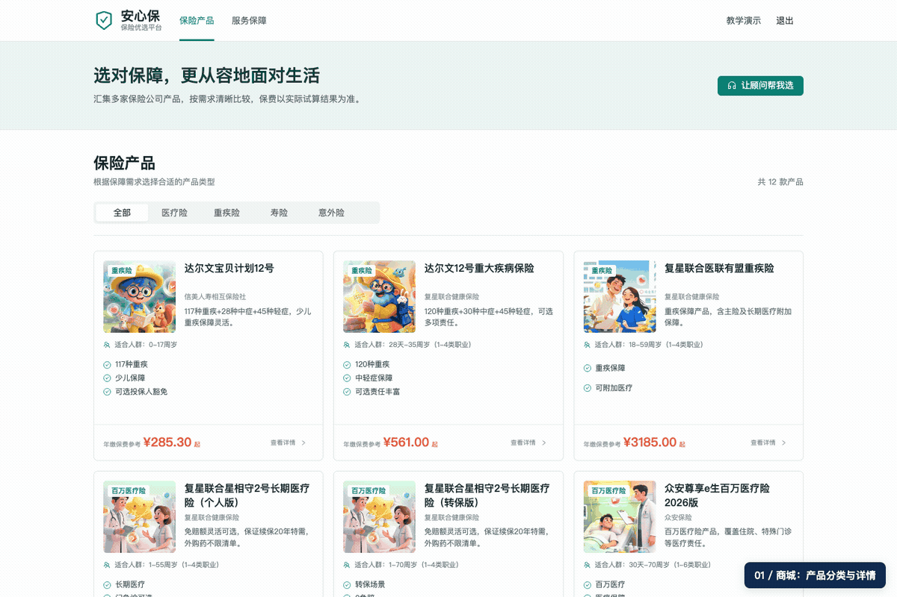
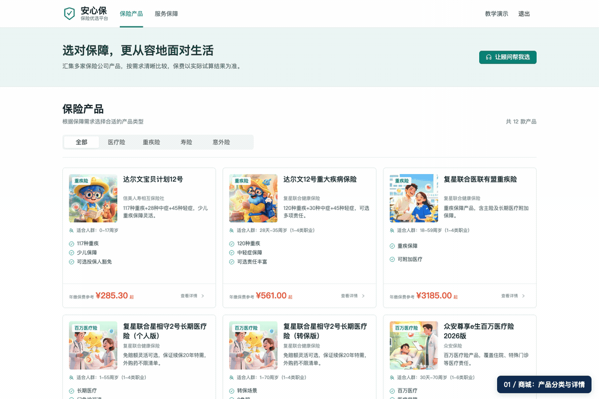
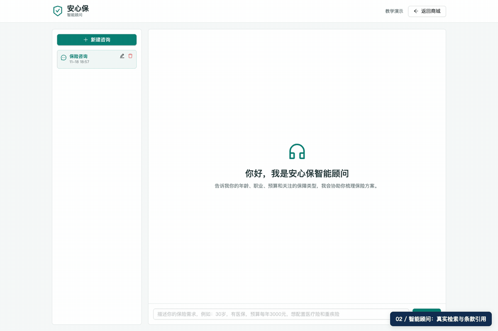
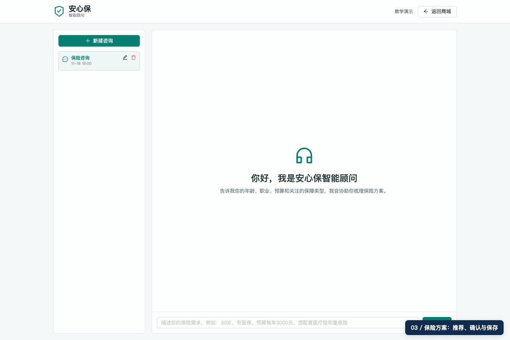
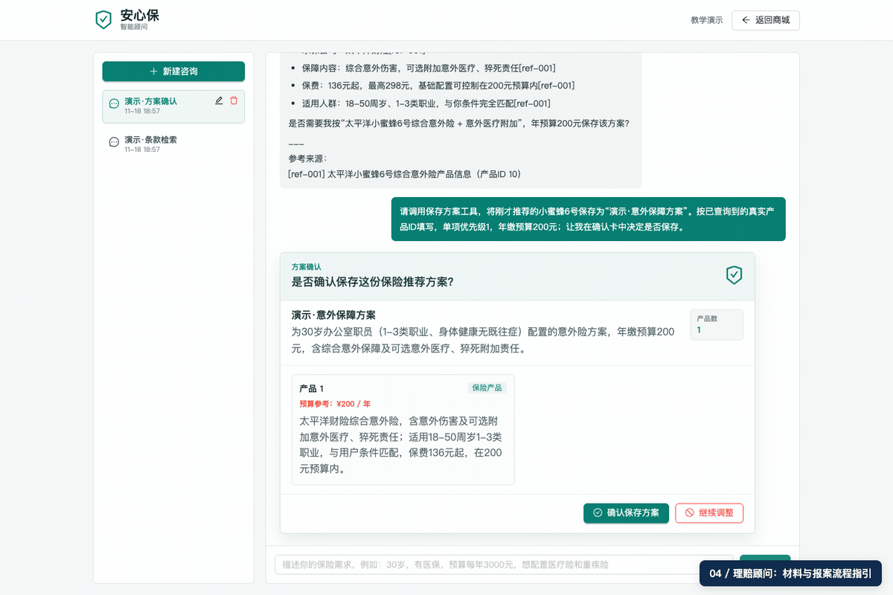
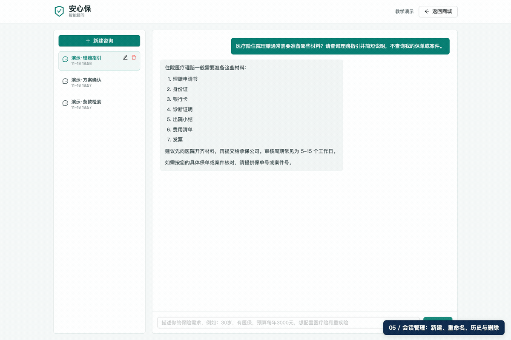
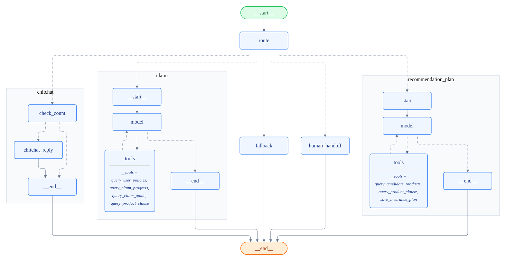

# 安心保 · AI 保险商城与智能顾问

基于 React、FastAPI、LangChain 和 LangGraph 的保险咨询项目，包含产品浏览、条款检索、保险方案确认、理赔指引和多会话管理。

**React 18 · FastAPI · LangGraph · PostgreSQL · Milvus · Gitleaks**

从产品选择、条款溯源到推荐方案确认，演示一套保险场景的多智能体应用。当前根项目与后端版本为 `1.0.0`，前端版本为 `0.1.1`。

[功能演示](#分步演示) · [Agent 流程图](#架构与-agent-流程) · [快速开始](#快速开始) · [安全扫描](#安全检查与-git-hooks) · [已知限制](#当前限制与贡献)



完整演示约 82 秒，涵盖产品筛选、条款引用、方案确认保存、理赔指引与会话管理。静态预览：[商城首页](backend/docs/assets/home.png) · [条款抽屉](backend/docs/assets/clause-citation.png) · [方案确认卡](backend/docs/assets/plan-confirmation.png)。

## 功能概览

| 功能 | 当前实现 |
| --- | --- |
| 产品商城 | 展示医疗险、重疾险、意外险和寿险，支持分类筛选、产品信息查看 |
| 智能推荐 | 询问用户需求、查询候选产品、生成保险组合，确认后保存推荐方案 |
| 条款问答 | 按产品检索条款，回答附带 `[ref-001]` 等引用，前端展示来源内容 |
| 理赔咨询 | 查询逻辑涵盖保单、理赔进度和材料指引；当前保单/进度工具存在上下文取值问题 |
| 闲聊处理 | 规则优先处理寒暄；独立子图检查次数，再决定是否调用模型回复 |
| 会话管理 | 创建、查看、重命名、删除会话，恢复历史消息及待确认方案 |
| 流式交互 | SSE 推送文字、引用等附加信息、方案确认中断和结束标识 |
| 人工服务 | 已有意图和占位节点，尚未接入实际人工客服系统 |

推荐方案保存不等于完成投保；当前 Python 后端没有完整的投保、支付、保单签发或理赔赔付接口。

## 分步演示

以下 GIF 来自本机运行的真实前后端，包含页面点击、模型回复与接口交互。录制仅展示本次创建的演示会话，压缩未变化的等待画面，不替换后端回复。录制环境与逐段结果见 [录制清单](backend/docs/demo/demo-manifest.json)，复录方式见 [演示说明](backend/docs/demo/README.md)。

### 1. 产品浏览

在不同险种之间筛选，打开产品详情。初始化 SQL 提供 12 款教学产品。



### 2. 条款与引用

咨询达尔文 12 号的等待期，点击引用打开条款来源抽屉。引用内容来自实际 RAG 检索。



### 3. 方案确认

根据预算查询候选产品，生成小蜜蜂 6 号意外保障方案，展示确认卡并由用户决定是否保存。保存工具在确认前通过 `interrupt()` 暂停。



### 4. 理赔指引

咨询医疗险理赔材料，展示理赔顾问的流程指引。保单和案件查询的当前限制见文末；此片段不涉及真实报案或赔付。



### 5. 会话管理

新建、切换、重命名及删除咨询会话。



## 架构与 Agent 流程



浏览器通过 Vite 代理访问 FastAPI。聊天请求先校验会话归属，再由主图进行意图识别，进入推荐、理赔、闲聊、人工或兜底节点。对话状态与中断信息通过 PostgreSQL 检查点持久化。

推荐与理赔 Agent 共用条款检索工具。RAG 使用 Milvus 查询子块，再回到 PostgreSQL 读取父块，将完整章节及引用信息交给模型与前端。

| 层次 | 主要职责 |
| --- | --- |
| `frontend/` | 产品页面、顾问对话、引用展示、方案确认和会话管理 |
| `backend/src/agent_service/modules/` | HTTP 接口、业务服务、数据仓储和请求响应结构 |
| `backend/src/agent_service/agents/` | 意图路由、主图、推荐与理赔工具、闲聊子图 |
| `backend/src/agent_service/rag/` | PDF 解析、父子分块、混合检索及父块回查 |
| `backend/src/agent_service/infra/` | 异步数据库连接、LangGraph 检查点连接池 |
| `deploy/` | PostgreSQL、Milvus、etcd、MinIO 与 Attu 等基础组件 |

## 技术栈

| 范围 | 技术 |
| --- | --- |
| 前端 | React 18、TypeScript、Vite 6、Ant Design 5 |
| 后端 | Python 3.14+、FastAPI、Pydantic Settings、SQLAlchemy 异步会话 |
| Agent | LangChain、LangGraph、DeepSeek 兼容模型调用 |
| 存储 | PostgreSQL 16、Milvus、LangGraph PostgreSQL Checkpointer |
| RAG | MinerU、Ollama Embeddings、BM25 中文分析器、Ali reranker |
| 工具 | uv、pnpm、Task、Ruff、Pyright、Husky、Commitlint、Gitleaks |

## 快速开始

以下命令均从仓库根目录执行。准备 Python 3.14+、uv、Node.js、pnpm、Task、Docker Compose；前端锁定 `pnpm@12.21.0`。启用提交钩子还需要本机可执行的 Gitleaks。

```bash
pnpm install
task be:install
cp -n backend/.env.example backend/.env
cp -n frontend/.env.example frontend/.env.local
```

编辑本地 `backend/.env`，填入自己的模型与文档解析凭据，并核对下一节的配置差异。复制命令保留已有本地配置，不要提交真实凭据。

```bash
task infra:up
ollama pull qwen3-embedding:4b
```

Ollama 需要另行安装并启动；Compose 没有提供 Ollama 或模型推理服务。PostgreSQL 初始化 SQL 只在首次创建空数据卷时执行；已有数据库需确认业务表及演示数据已就绪，不要通过删除数据卷处理配置问题。

分别在两个终端启动：

```bash
task be:dev
```

```bash
task fe:dev
```

默认访问前端 `http://localhost:5173`、后端文档 `http://localhost:8001/docs`，健康检查为 `http://localhost:8001/health`。前端 `/api` 默认代理到 `127.0.0.1:8001`。

也可使用 `uv run --directory backend python -m agent_service.main` 启动后端。当前 `agent-service` 脚本只打印问候文字，不是 HTTP 服务入口。

## 环境变量

后端从 `backend/.env` 读取配置，定义见 [config.py](backend/src/agent_service/core/configs/config.py)；Compose 使用 `deploy/` 下的环境配置，二者不是同一个 `.env`。

| 变量 | 用途与注意事项 |
| --- | --- |
| `APP_NAME` | 应用标题 |
| `APP_DEBUG` | FastAPI 调试开关 |
| `APP_HOST` / `APP_PORT` | 直接运行 Python 入口时的监听地址与端口；Task 开发任务固定为 `0.0.0.0:8001` |
| `LOGGING_LEVEL` | 日志级别，如 `INFO`、`DEBUG` |
| `DB_HOST` / `DB_PORT` | PostgreSQL 主机与宿主机映射端口 |
| `DB_NAME` | 声明的数据库名；当前 DSN 构造尚未包含此字段 |
| `DB_USER` / `DB_PASSWORD` | 数据库身份信息，需与实际服务配置一致 |
| `DB_ECHO` | 是否输出 SQL，默认 `false` |
| `DB_POOL_SIZE` / `DB_MAX_OVERFLOW` | SQLAlchemy 常驻及额外连接数量 |
| `DB_POOL_TIMEOUT` / `DB_POOL_RECYCLE` | 连接池等待时间与连接回收周期 |
| `DEEPSEEK_API_KEY` | 当前聊天模型与文档整理模型的调用凭据 |
| `CHAT_MODEL` | 账户可用的模型标识；必要时使用 `deepseek:模型名`，不能填 API URL |
| `DASHSCOPE_API_KEY` / `DASHSCOPE_BASE_URL` | Settings 已声明；主聊天模型初始化没有直接使用这两个字段 |
| `MINERU_TOKEN` | MinerU 文档解析凭据 |
| `MILVUS_HOST` / `MILVUS_PORT` | Milvus 地址，默认端口 `19530` |
| `VITE_BACKEND_HOST` / `VITE_BACKEND_PORT` | 前端 Vite 代理目标，在前端环境配置中设置 |

启动前重点核对：

1. 模板的 `DB_PORT=15432` 与 Compose 默认宿主机端口 `5432` 不一致；密码也应与部署配置核对。
2. 当前 `DB_NAME` 未写入数据库连接 URL，用户名与数据库名不一致时可能连接错误；修改该变量本身不能解决此问题。
3. 模板 `CHAT_MODEL` 目前误填 URL，应替换为有效模型标识；仅填写 API Key 不足以运行。
4. 模板的 `SILICON_*` 当前没有对应 Settings 字段，不会自动改变模型提供方；本地 Ollama 地址也尚未暴露为项目环境变量。

## 导入保险条款知识库

先准备产品记录，并确保各产品的 `clause_name` 与 PDF 文件名一致。将 PDF 放入 `backend/data/raw/kb/`；同时准备 PostgreSQL、Milvus、Ollama、MinerU 和模型服务。

```bash
uv run --directory backend python scripts/ingest_rag.py
```

导入过程依次执行：

1. 从数据库查询已上架产品，按 `clause_name` 读取条款 PDF。
2. MinerU 解析 PDF，模型整理 Markdown 标题与结构。
3. 按标题生成父块，再切分约 500 字符、重叠 50 字符的子块。
4. 将父块保存到 PostgreSQL `parent_chunks`，子块向量保存到 Milvus `insurance_collection`。
5. 检索时组合稠密向量与 BM25，并使用 `gte-rerank-v2` 重排，再回查父块。

脚本会替换对应产品已有知识块；PostgreSQL 与 Milvus 的更新不是同一个事务。导入会产生外部模型调用，逐产品成功与失败数量以脚本日志为准。重排服务的凭据还需按 Milvus 部署方式配置。

## API 与 SSE 协议

| 方法 | 路径 | 功能 |
| --- | --- | --- |
| `GET` | `/health` | 服务健康响应 |
| `GET` | `/api/v1/products` | 已上架产品，支持 `category` |
| `GET` | `/api/v1/products/page` | 按分类、名称分页查询 |
| `GET` | `/api/v1/products/candidates` | 多分类候选，支持 `premium_min`、`limit_per_category` |
| `POST` | `/api/v1/chat-threads` | 创建会话 |
| `GET` | `/api/v1/chat-threads` | 当前用户会话列表 |
| `PATCH` | `/api/v1/chat-threads/{thread_id}` | 重命名会话 |
| `DELETE` | `/api/v1/chat-threads/{thread_id}` | 删除会话及检查点历史 |
| `GET` | `/api/v1/chat-threads/{thread_id}/messages` | 历史消息、引用及当前中断 |
| `POST` | `/api/v1/chat` | SSE 聊天及方案确认恢复 |
| `POST` | `/api/v1/chat/sse` | 固定数据演示接口 |

会话和聊天请求通过 `x-user-id` 传入用户标识，并检查会话归属；这不是登录认证，当前没有 JWT 验证。`premium_min` 实际作为最低保费的严格上限使用，即 `min_premium < premium_min`。

创建会话后，将返回的 ID 用于聊天请求：

```bash
curl -X POST http://localhost:8001/api/v1/chat-threads \
  -H 'Content-Type: application/json' -H 'x-user-id: 1' \
  -d '{"title":"保险咨询"}'
curl -N -X POST http://localhost:8001/api/v1/chat \
  -H 'Content-Type: application/json' -H 'x-user-id: 1' \
  -d '{"thread_id":"替换为返回的会话UUID","message":"你好"}'
```

| SSE 事件 | 数据含义 |
| --- | --- |
| `message` | AI 回复文字片段 |
| `additional_info` | 条款来源或关联保单等结构化业务数据 |
| `interrupt` | 保存方案前的确认信息：`plan`、`confirm_info`、`action` |
| `done` | 当前执行结束，值为 `[DONE]`；中断时收到它不代表方案已保存 |

确认或拒绝时向同一路径提交 `decision`，使用同一个 `thread_id`，不需要重新发送原问题：

```json
{"thread_id":"原会话UUID","decision":{"action":"approve"}}
```

拒绝可使用 `{"action":"reject","reject_reason":"需要调整预算"}`。当前请求模型未严格约束 `message` 与 `decision` 互斥，调用方应只提交其中一个。

## 目录结构

```text
hm-insurance/
├── backend/
│   ├── src/agent_service/
│   │   ├── agents/          # 主图、意图识别、闲聊、推荐和理赔
│   │   ├── modules/         # chat、chat_thread、product、insurance_plan 等
│   │   ├── rag/             # 条款导入、父子分块和检索
│   │   ├── infra/           # 数据库与检查点
│   │   ├── core/            # 配置、日志与异常
│   │   └── main.py          # FastAPI 入口
│   ├── scripts/ingest_rag.py
│   ├── docs/                # 演示、扫描记录与说明
│   ├── graph_output.png
│   └── pyproject.toml
├── frontend/                # React 应用
├── deploy/                  # Compose 与数据库初始化 SQL
├── .husky/                  # 提交前扫描和提交信息检查
├── .gitleaks.toml
└── Taskfile.yml
```

## 开发任务

完整定义以 [Taskfile.yml](Taskfile.yml) 为准，根目录执行 `task --list` 查看。

| 任务 | 用途 |
| --- | --- |
| `task be:install` / `task fe:install` | 安装后端或前端依赖 |
| `task be:dev` / `task fe:dev` | 启动开发服务 |
| `task be:lint` / `task be:typecheck` | Ruff 检查和格式检查 / Pyright |
| `task be:check` | 汇总后端静态检查 |
| `task be:fmt` | 自动修改后端格式与可修复问题 |
| `task fe:lint` / `task fe:build` | 前端静态检查 / 生产构建 |
| `task infra:up` / `task infra:down` | 启动或停止基础组件 |
| `task release:plan` / `task release:bump` | 创建 Changeset / 同步版本与更新日志 |
| `task release:commit` / `task release:publish` | 暂存并提交全部变更 / 推送 `main` 与标签 |

## 安全检查与 Git Hooks

根目录 `.gitleaks.toml` 继承默认规则并补充 AI 凭据规则，排除依赖锁文件；检查任务均使用 `--redact=100`。

```bash
task security:scan       # 当前暂存差异
task security:scan:all   # 本地完整 Git 历史
task security:scan:dir   # 真实工作目录，范围包含未提交文件
```

`pnpm install` 的 `prepare` 脚本安装 Husky；必要时可在根目录执行 `pnpm exec husky`。现有 `pre-commit` 调用 `task security:scan`，`commit-msg` 调用 Commitlint；没有自动运行全部测试或前端检查的提交钩子。

2026-11-18 的 [扫描与静态检查记录](backend/docs/security/SCAN-RESULTS.md) 显示：暂存区扫描 0 项；完整历史与受 Git 跟踪文件的工作树快照各命中 1 项，来自同一文件位置。Ruff、格式检查和 Pyright 未通过；前端 ESLint 因缺少配置未完成检查。

该工作树快照不等于 `security:scan:dir` 的真实目录扫描，已有 `dist/` 也不能证明当前前端构建通过。凭据内容没有写入报告；已报告的疑似泄露应由所有者确认并撤销或轮换，不能靠扩大白名单解决。

## 当前限制与贡献

- 理赔工具仍将 TypedDict 上下文按属性访问，保单及进度查询需修复；材料指南为静态文案，通用下载链接仍是占位符。
- 人工节点只有回复，没有转接、工单或人工队列；前端投保页面引用的部分业务 API 尚未在当前 Python 后端注册。
- Agent 路由仍同步调用模型；连续 fallback 升级策略尚未实现，闲聊私有计数在跨流程与规则寒暄组合下仍需完善。
- 初始化 Agent 时会在线生成 `graph_output.png`，渲染服务失败可能影响启动；RAG 模块也在启动阶段初始化外部组件。
- 配置模板、数据库名连接问题与校验结果仍待完善；业务表需通过 `deploy/postgres/init/` 初始化，后端仅自动准备检查点表。
- 当前根 `pnpm test` 为占位脚本，没有可据此宣称通过的自动化测试套件。

贡献前请阅读相关模块和现有检查记录，保持接口兼容，补充改动范围与实际验证结果。可运行 `task be:check`、`task fe:lint`、`task fe:build` 和安全扫描；有失败时记录原因，不将未执行或未通过写成通过。

提交信息遵循 Conventional Commits，可使用 `pnpm commit`。需要版本变更时创建 Changeset；提交 PR 前确认不包含 `.env`、真实凭据、个人数据或临时运行日志。
