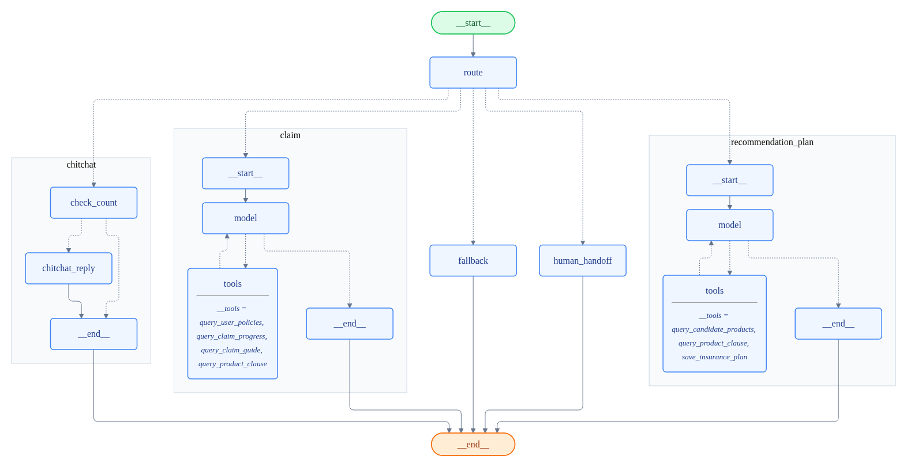
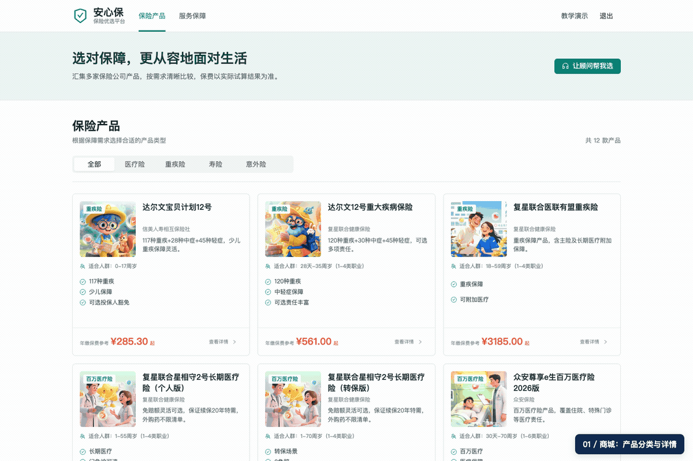
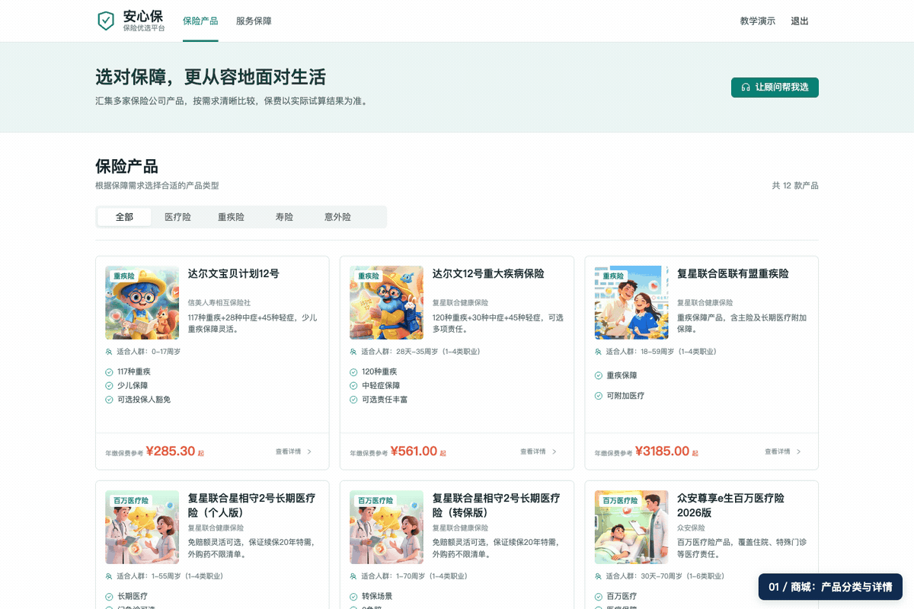
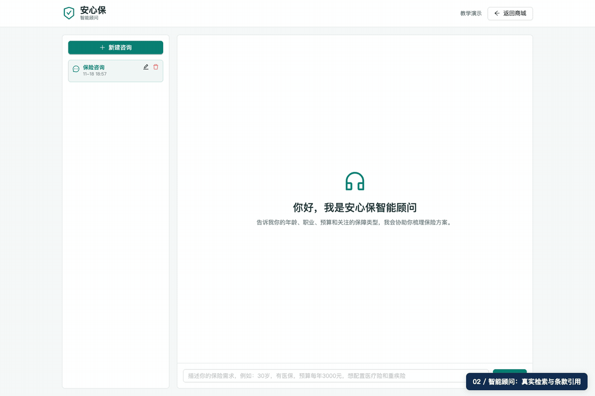
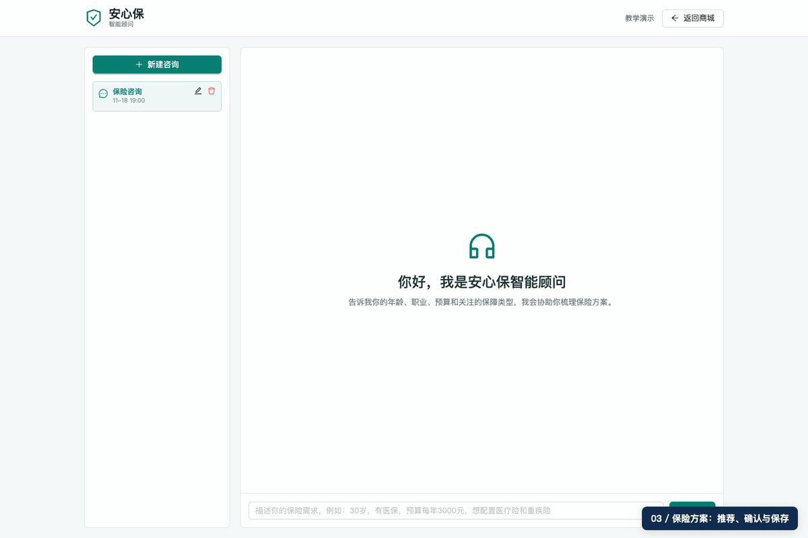
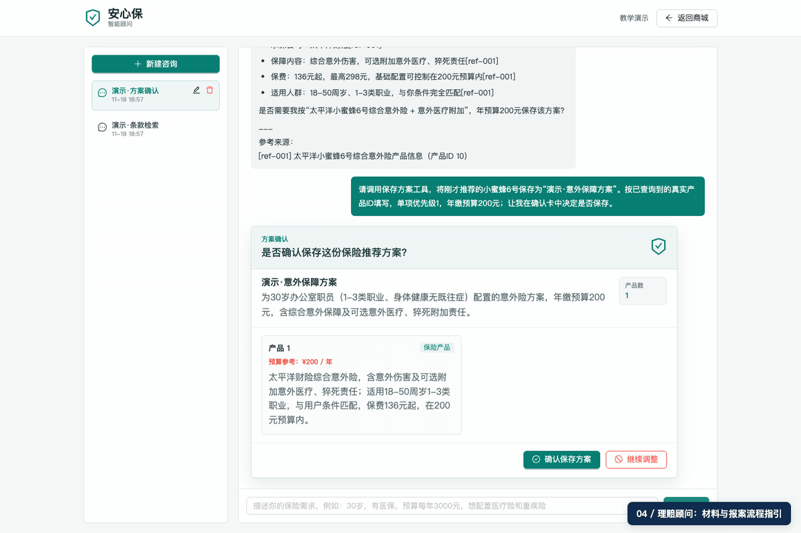
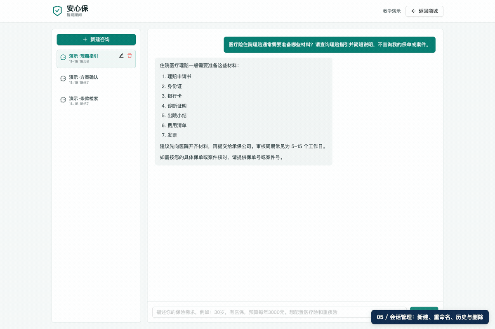

# 安心保后端

基于 FastAPI、LangChain 和 LangGraph 的保险智能顾问服务，提供产品查询、会话管理、SSE 对话、条款检索和推荐方案确认。

完整的商城、前后端启动、功能演示、API 与安全说明见[项目 README](../README.md)。

## Agent 流程



## 功能演示

产品浏览 → 条款引用 → 推荐方案确认 → 理赔指引 → 会话管理，约 82 秒：



### 分段观看











复录脚本、环境与逐段状态见[演示说明](./docs/demo/README.md)。

## 本地启动

在本目录执行：

```bash
uv sync
cp -n .env.example .env
# 编辑 .env：填写自己的凭据，核对数据库/Milvus 端口与模型标识。
uv run uvicorn agent_service.main:app --reload --host 0.0.0.0 --port 8001
```

启动前需准备 PostgreSQL 业务表、Milvus、Ollama 及模型/文档解析配置；详细配置差异与知识库导入见[项目 README](../README.md#快速开始)。

- API 文档：<http://localhost:8001/docs>
- 健康检查：<http://localhost:8001/health>
- Python：3.14+
- HTTP 服务入口：`agent_service.main:app`；`uv run agent-service` 当前仅打印问候文字。

## 安全扫描与检查

在仓库根目录运行 `task security:scan`、`task security:scan:all`、`task security:scan:dir`。

Gitleaks 已接入 Husky 提交前钩子，使用根目录规则和 `--redact=100`。2026-11-18 检查发现：暂存区 0 项，Git 历史与当前受跟踪文件各命中同一处疑似凭据；静态检查也有待修复项。完整结果见[安全扫描记录](./docs/security/SCAN-RESULTS.md)，请勿将“已配置扫描”理解为“全部检查通过”。
